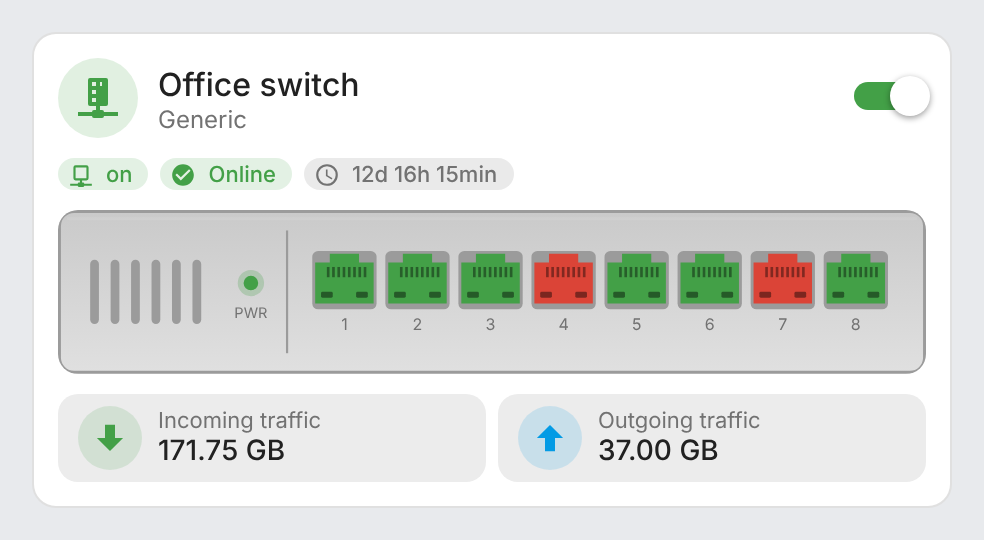
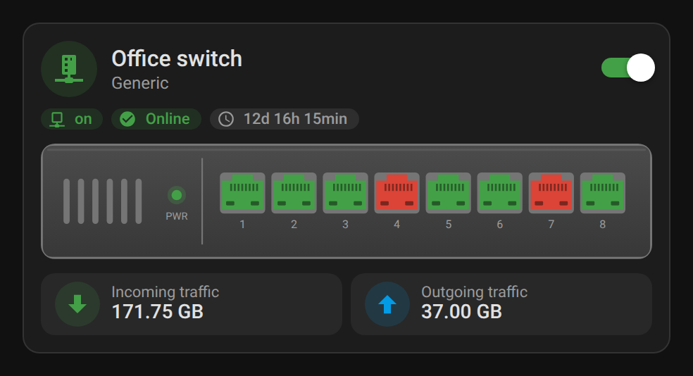
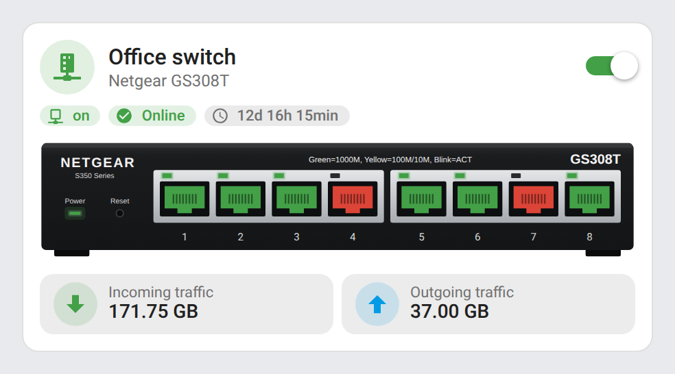

# ha-switch

[](https://github.com/hacs/integration)
[](https://github.com/juju35/ha-switch/actions/workflows/hacs.yml)
[](https://github.com/juju35/ha-switch/actions/workflows/validate.yml)
[](https://github.com/juju35/ha-switch/releases/latest)
[](LICENSE)

Custom Lovelace card for Home Assistant displaying a managed network switch (SNMP): power toggle, global status, connectivity, uptime, per-port state and traffic. Pure JavaScript, no dependencies (no mushroom, card-mod or button-card required). Fully configurable from the visual editor. FR/EN auto-detected.

[](https://my.home-assistant.io/redirect/hacs_repository/?owner=juju35&repository=ha-switch&category=plugin)

| Generic front panel | Netgear GS308T (embedded photo) |
|---|---|
|  |  |

## Features

- Header with a status-colored icon, name, subtitle and power toggle
- Chips for connectivity, global status and uptime (SNMP timeticks or seconds)
- Live state of every port on the device; tap a port to open its entity
- Incoming / outgoing traffic, auto-scaled (B → TB)
- Built-in devices: a drawn generic front panel (1–52 ports) that follows the light or dark theme, or a Netgear GS308T (S350) photo with calibrated ports
- Custom image support with an adjustable port overlay
- Status colors from the Home Assistant theme
- Visual editor in the dashboard UI (no YAML needed), English and French
- Single file, no dependencies (no mushroom, card-mod or button-card)

## Prerequisites

Home Assistant 2024.8 or later, and:

Entities describing your switch, usually from the [SNMP integration](https://www.home-assistant.io/integrations/snmp/): one sensor per port with its operational status (`1` = up), plus optional status, connectivity, uptime and traffic sensors and a power switch. Every entity is optional; the card shows what is configured.

## Installation

### Via HACS (recommended)

Click the button below to add the repository directly:

[](https://my.home-assistant.io/redirect/hacs_repository/?owner=juju35&repository=ha-switch&category=plugin)

Then click **Download**, and reload your browser when HACS asks you to.

Or manually:

1. Open HACS → **⋮** (top right) → **Custom repositories**
2. Add `https://github.com/juju35/ha-switch` — Type: **Dashboard**
3. Search for **Network Switch Card** and click **Download**
4. Clear your browser cache and refresh

### Manual

1. Download `ha-switch-card.js` from the [latest release](https://github.com/juju35/ha-switch/releases/latest).
2. Copy it to `/config/www/ha-switch-card.js`.
3. Go to **Settings → Dashboards → ⋮ → Resources** and add `/local/ha-switch-card.js` as a **JavaScript module**, or in YAML mode:

   ```yaml
   lovelace:
     resources:
       - url: /local/ha-switch-card.js
         type: module
   ```

4. Reload your browser.

## Configuration

### Visual editor

Edit a dashboard, click **Add card** and search for **Network switch card**. Every option below is available in the editor, grouped by entities, ports and appearance.

### Full options

```yaml
type: custom:ha-switch-card
name: Living room switch Netgear S350 (GS308T)
subtitle: 8 monitored ports
icon: mdi:switch
switch_entity: switch.living_room_switch
status_entity: sensor.living_room_switch_global_status
connectivity_entity: binary_sensor.living_room_switch
uptime_entity: sensor.living_room_switch_uptime
traffic_in_entity: sensor.living_room_switch_port_1_in
traffic_out_entity: sensor.living_room_switch_port_1_out
ports: 8
port_pattern: sensor.living_room_switch_port_{n}_status
model: gs308t
url: http://switch.local
```

### Options reference

| Option | Default | Description |
|---|---|---|
| `name` | `Switch` | Title |
| `subtitle` | – | Subtitle |
| `icon` | `mdi:switch` | Header icon, colored by status |
| `switch_entity` | – | Power toggle (`switch` / `input_boolean`) |
| `status_entity` | – | Global status sensor |
| `connectivity_entity` | – | Connectivity `binary_sensor` |
| `uptime_entity` | – | Uptime sensor |
| `uptime_unit` | `timeticks` | `timeticks` (SNMP, 1/100 s) or `seconds` |
| `traffic_in_entity` / `traffic_out_entity` | – | Traffic sensors (bytes, auto-scaled) |
| `ports` | `8` | Number of ports |
| `port_pattern` | `sensor.switch_port_{n}_status` | Port entity pattern, `{n}` = port number |
| `port_on_state` | `1` | State meaning "port up" |
| `online_state` / `idle_state` | `En ligne` / `Inactif` | Values of `status_entity` shown green / orange (anything else → red). Set them to the states your status sensor reports, e.g. `online` / `idle` |
| `model` | `generic` | Embedded device image: `generic` (drawn front panel, any port count, up to 52) or `gs308t` (Netgear GS308T / S350 photo, calibrated ports) |
| `image` | – | Custom device image URL, overrides `model` |
| `port_start` / `port_step` / `port_bottom` | `21` / `10` / `39` | Port overlay position on a custom `image` (%) |
| `url` | – | Opened when tapping the device |

Tapping any chip, tile or port opens its more-info dialog.

## Screenshots

| Light | Dark (French) |
|---|---|
|  |  |
|  | |

## How it works

Ports are read from `port_pattern` with `{n}` replaced by the port number, and drawn green when their state equals `port_on_state`, red otherwise, grey when the entity is missing. The header icon and the power LED follow `status_entity` (`online_state` green, `idle_state` orange, anything else red), or `connectivity_entity` when no status is set.

The generic front panel is an SVG drawn by the card: up to 12 ports on one row, beyond that odd ports on top and even ports below, like real switches. Its body is derived from the theme's card and text colors, so it stays readable in light and dark mode.

## Development

```bash
npm install
npm run build        # stamps the version of package.json into dist/ha-switch-card.js
npm run check        # builds and checks the card (run in CI)
npm run screenshots  # renders the card with mock entities into screenshots/
```

`dist/` is not committed: `npm run build` creates it locally, CI builds it on every push, and the release workflow attaches the built file to the release, which is where HACS downloads it from.

### Releasing

1. Bump `version` in `package.json`
2. Add a `## <version>` section at the top of [CHANGELOG.md](CHANGELOG.md)
3. Push to `main`: the **Release** workflow builds the card, creates the tag and the GitHub release with the changelog section as notes, and attaches `ha-switch-card.js`

## Translations

The card auto-detects the language from your Home Assistant settings. Currently supported:

| Language | Code |
|---|---|
| English | `en` |
| Français | `fr` |

Contributions for additional languages are welcome!

## License

[MIT](LICENSE)
