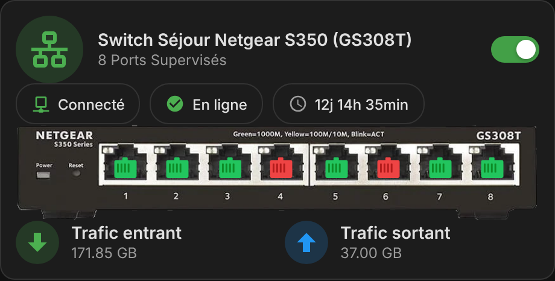
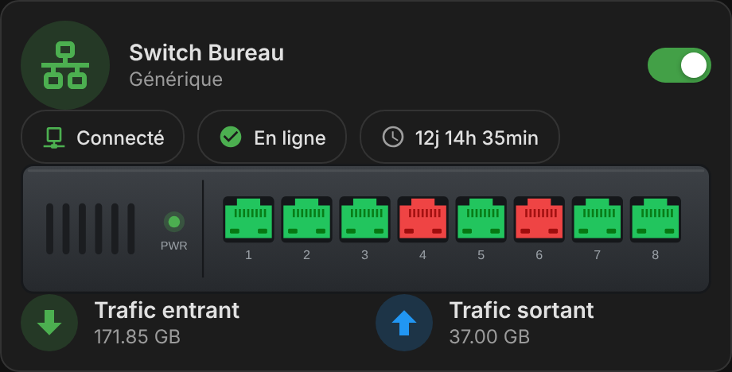

# ha-switch

[](https://github.com/hacs/integration)
[](https://github.com/juju35/ha-switch/actions/workflows/hacs.yml)
[](https://github.com/juju35/ha-switch/actions/workflows/validate.yml)
[](https://github.com/juju35/ha-switch/releases/latest)
[](LICENSE)

[](https://my.home-assistant.io/redirect/hacs_repository/?owner=juju35&repository=ha-switch&category=plugin)

Custom Lovelace card for Home Assistant displaying a managed network switch (SNMP): power toggle, global status, connectivity, uptime, per-port state and traffic. Pure JavaScript, no dependencies (no mushroom, card-mod or button-card required). Fully configurable from the visual editor. FR/EN auto-detected.

| Netgear GS308T (embedded) | Generic front panel |
|---|---|
|  |  |

## Installation

### HACS (recommended)

Use the **Open in HACS** badge above, or manually:

1. Open **HACS** in Home Assistant.
2. Click the **⋮** menu (top right) → **Custom repositories**.
3. Add `https://github.com/juju35/ha-switch` with type **Dashboard**, then click **Add**.
4. Search for **ha-switch** in HACS, open it and click **Download**.
5. Reload your browser (clear the cache if the card doesn't show up).

HACS registers the dashboard resource automatically.

### Manual

1. Download `ha-switch-card.js` from the [latest release](https://github.com/juju35/ha-switch/releases/latest) (or `dist/` in this repository).
2. Copy it to `/config/www/ha-switch-card.js`.
3. Go to **Settings → Dashboards → ⋮ → Resources** and add `/local/ha-switch-card.js` as a **JavaScript module**, or in YAML mode:

   ```yaml
   lovelace:
     resources:
       - url: /local/ha-switch-card.js
         type: module
   ```

4. Reload your browser.

## Configuration

```yaml
type: custom:ha-switch-card
name: Switch Séjour Netgear S350 (GS308T)
subtitle: 8 Ports Supervisés
icon: phu:netgear-switch
switch_entity: switch.switch_sejour
status_entity: sensor.switch_sejour_statut_global
connectivity_entity: binary_sensor.switch_sejour
uptime_entity: sensor.switch_sejour_uptime
traffic_in_entity: sensor.switch_sejour_port_1_in
traffic_out_entity: sensor.switch_sejour_port_1_out
ports: 8
port_pattern: sensor.switch_sejour_port_{n}_status
model: gs308t
url: http://192.168.1.117
```

| Option | Default | Description |
|---|---|---|
| `name` | `Switch` | Title |
| `subtitle` | – | Subtitle |
| `icon` | `mdi:switch` | Header icon, colored by status |
| `switch_entity` | – | Power toggle (`switch` / `input_boolean`) |
| `status_entity` | – | Global status sensor |
| `connectivity_entity` | – | Connectivity `binary_sensor` |
| `uptime_entity` | – | Uptime sensor |
| `uptime_unit` | `timeticks` | `timeticks` (SNMP, 1/100 s) or `seconds` |
| `traffic_in_entity` / `traffic_out_entity` | – | Traffic sensors (bytes, auto-scaled) |
| `ports` | `8` | Number of ports |
| `port_pattern` | `sensor.switch_port_{n}_status` | Port entity pattern, `{n}` = port number |
| `port_on_state` | `1` | State meaning "port up" |
| `online_state` / `idle_state` | `En ligne` / `Inactif` | Status values → green / orange (anything else → red) |
| `model` | `generic` | Embedded device image: `generic` (drawn front panel, any port count, up to 52) or `gs308t` (Netgear GS308T / S350 photo, calibrated ports) |
| `image` | – | Custom device image URL, overrides `model` |
| `port_start` / `port_step` / `port_bottom` | `21` / `10` / `39` | Port overlay position on a custom `image` (%) |
| `url` | – | Opened when tapping the device |

Tapping any chip, tile or port opens its more-info dialog.

## License

MIT — see [LICENSE](LICENSE).
